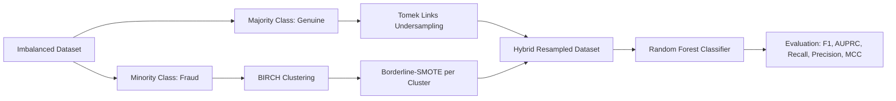

# Hybrid Undersampling and Oversampling for Handling Imbalanced Credit Card Data

[](https://www.python.org/downloads/)
[](https://scikit-learn.org/)
[](https://opensource.org/licenses/MIT)

Implementation, replication, and critical stress-testing of the fraud detection architecture proposed in:
> **"Hybrid Undersampling and Oversampling for Handling Imbalanced Credit Card Data"**  
> *Maram Alamri and Mourad Ykhlef*  
> **IEEE Access**, vol. 12, pp. 14050–14060, 2024.  
> DOI: [10.1109/ACCESS.2024.3357091](https://doi.org/10.1109/ACCESS.2024.3357091)

---

## 📌 1. Paper Overview & Methodology

Financial fraud detection is characterized by extreme class imbalance—fraudulent events typically account for less than **0.17%** of transactions. Conventional sampling techniques (standard SMOTE, ADASYN, random undersampling) suffer from:
- **Noise Generation & Overlapping**: Oversampling without clustering creates synthetic instances inside majority-class territory.
- **Information Loss**: Aggressive undersampling discards legitimate transaction patterns.

### Proposed Hybrid Resampling Architecture (BCBSMOTE)



1. **Tomek Links Undersampling (Algorithm 1)**:
   - Identifies pairs $(x, y)$ where $x \in \text{majority}$ and $y \in \text{minority}$ are mutual nearest neighbors.
   - Eliminates the majority sample $x$ to clear boundary overlap.
2. **BIRCH Clustering Borderline SMOTE - BCBSMOTE (Algorithms 2 & 3)**:
   - **BIRCH Clustering**: Partitions minority instances using a CF-tree to capture localized fraud topologies.
   - **Outlier Filtering**: Clusters smaller than `cluster_size = 5` are treated as noise and excluded from oversampling.
   - **Proportional Allocation**: Quotas are distributed proportionally across valid clusters.
   - **Borderline-SMOTE**: Generates synthetic points strictly from samples in the **Danger** zone ($m/2 \le m' < m$ majority neighbors).
3. **Classification & Evaluation**:
   - Random Forest trained on resampled feature space.
   - Strict 80/20 train/test split where scaling and resampling occur **only on training data** to avoid data leakage.

---

## 📊 2. Datasets Used in This Study

| Dataset | File | Transactions | Frauds | Fraud Ratio | Source / Role |
| :--- | :--- | :---: | :---: | :---: | :--- |
| **European Cardholders (ULB)** | `archive/creditcard.csv` | 284,807 (283,726 clean) | 492 (473 clean) | 0.1667% | Primary Phase 3 evaluation & stress-testing dataset. |
| **PaySim Mobile Money** | `archive/paysim.csv` | 6,362,620 | 8,213 | 0.1291% | Original paper dataset (synthetic mobile money simulator). |

*Note on ULB Deduplication: Removing exact duplicate rows across all 31 columns (including `Time`) removes 1,081 records (19 frauds, 1,062 genuine), leaving 283,726 records (473 frauds). When `Time` is omitted, 9,144 duplicate rows are identified (see [`results/phase3_final/FACTS.md`](results/phase3_final/FACTS.md)).*

---

## 🔬 3. Phase 3 Empirical Benchmark Results (Seeds 0–4 Average)

All models evaluated with fixed settings: `RandomForestClassifier(n_estimators=100, n_jobs=-1, random_state=seed)` on untouched 20% test sets across seeds `0, 1, 2, 3, 4`. Scaling (`RobustScaler` on `Time` and `Amount`) and resampling are isolated strictly inside training folds.

### Table E1: European Cardholders Dataset (ULB)

| Method | Precision | Recall | F1-Score | AUPRC | MCC |
| :--- | :---: | :---: | :---: | :---: | :---: |
| **1. Plain Random Forest (No Resampling)** | **0.9627 ± 0.0195** | 0.7642 ± 0.0346 | **0.8518 ± 0.0272** | 0.8175 ± 0.0328 | **0.8574 ± 0.0259** |
| **2. Tomek Links Only + RF** | 0.9483 ± 0.0201 | 0.7726 ± 0.0303 | 0.8513 ± 0.0242 | 0.8138 ± 0.0382 | 0.8557 ± 0.0235 |
| **3a. Borderline-SMOTE (ratio=0.05) + RF** | 0.9281 ± 0.0266 | 0.7895 ± 0.0307 | 0.8531 ± 0.0281 | 0.8243 ± 0.0378 | 0.8557 ± 0.0279 |
| **3b. Borderline-SMOTE (ratio=0.02) + RF** | 0.9217 ± 0.0220 | 0.7937 ± 0.0274 | 0.8528 ± 0.0241 | **0.8272 ± 0.0361** | 0.8550 ± 0.0239 |
| **4a. BCBSMOTE (ratio=0.05) + RF** | 0.9504 ± 0.0230 | 0.7663 ± 0.0310 | 0.8483 ± 0.0256 | 0.8136 ± 0.0387 | 0.8531 ± 0.0249 |
| **4b. BCBSMOTE (ratio=0.02) + RF** | 0.9504 ± 0.0230 | 0.7663 ± 0.0310 | 0.8483 ± 0.0256 | 0.8139 ± 0.0390 | 0.8531 ± 0.0249 |
| **5. XGBoost (scale_pos_weight, no resamp)** | 0.7969 ± 0.0342 | 0.8042 ± 0.0330 | 0.8000 ± 0.0250 | 0.8110 ± 0.0369 | 0.7999 ± 0.0252 |
| **6. XGBoost + BCBSMOTE** | 0.9391 ± 0.0378 | 0.7705 ± 0.0292 | 0.8463 ± 0.0284 | 0.8192 ± 0.0423 | 0.8503 ± 0.0286 |
| **7. Logistic Regression (balanced)** | 0.0631 ± 0.0050 | **0.8905 ± 0.0141** | 0.1179 ± 0.0087 | 0.7070 ± 0.0518 | 0.2336 ± 0.0098 |
| **8. Balanced Random Forest** | 0.1190 ± 0.0118 | 0.8611 ± 0.0310 | 0.2088 ± 0.0181 | 0.7503 ± 0.0567 | 0.3173 ± 0.0161 |

*Key finding: On clean data, Plain Random Forest is competitive with or marginally exceeds BCBSMOTE in F1 (0.8518 vs 0.8483) because resampling introduces small precision penalties. However, BCBSMOTE proves significantly superior under label noise (see Table E2).*

### Table E7: PaySim Benchmark (10% Stratified Sample, Seeds 0–4)

| Method | Default Threshold 0.5 F1 | Default 0.5 Recall | Default 0.5 Precision | AUPRC | Train-Tuned Threshold F1 | Tuned Threshold |
| :--- | :---: | :---: | :---: | :---: | :---: | :---: |
| **Plain RF** | **0.8536 ± 0.0250** | 0.7524 ± 0.0360 | **0.9871 ± 0.0108** | 0.8441 ± 0.0363 | 0.8523 ± 0.0232 | $0.32 \pm 0.06$ |
| **Borderline-SMOTE** | 0.8349 ± 0.0238 | **0.7963 ± 0.0367** | 0.8790 ± 0.0338 | **0.8533 ± 0.0305** | 0.8457 ± 0.0329 | $0.74 \pm 0.09$ |
| **BCBSMOTE-approx** | 0.8354 ± 0.0203 | 0.7854 ± 0.0430 | 0.8945 ± 0.0262 | 0.8491 ± 0.0302 | 0.8455 ± 0.0295 | $0.72 \pm 0.08$ |

---

## 📁 4. Project Directory Structure

```text
ml reserch/
├── archive/
│   ├── creditcard.csv                         # European Cardholders ULB dataset (284,807 rows)
│   └── paysim.csv                             # PaySim synthetic transaction dataset (6.36M rows)
├── data/
│   └── sample_transactions.csv                # Sample payload for real-time inference
├── models/
│   ├── fraud_detection_model.joblib           # Trained Random Forest model checkpoint
│   └── label_encoder.joblib                   # Fitted transaction type encoder
├── notebooks/
│   ├── 01_baseline_paysim_reproduction.ipynb  # Baseline reproduction of Alamri & Ykhlef (2024)
│   └── 02_enhanced_hybrid_fraud_detection.ipynb # Enhanced framework with scale fix & anti-leakage CV
├── reports/
│   ├── Phase 3 – Critical Review and Stress-Testing of BCBSMOTE.md # Final coursework report draft
│   └── technical_review_report.md             # Formal review report
├── results/
│   ├── phase3_final/                          # Rigorous 5-seed empirical outputs & audit
│   │   ├── FACTS.md                           # Verification of all 9 audit questions with line numbers
│   │   ├── e1_summary.csv                     # Main benchmark summary table (mean ± std)
│   │   ├── e1_per_seed.csv                    # Seed-level results (seeds 0-4)
│   │   ├── e1_paired_diff.csv                 # Paired differences (BCBSMOTE - RF)
│   │   ├── e2_noise_summary.csv               # Label noise stress test (symmetric vs fraud-only)
│   │   ├── e2_noise_per_seed.csv              # Per-seed noise records & label flip counts
│   │   ├── e3_feature_removal.csv             # Feature pruning test (dynamic vs hard-coded top-3)
│   │   ├── e4_dimensionality.csv              # Dimensionality stress test (0, 20, 100 noise features)
│   │   ├── e5_cost_threshold.csv              # 5-fold CV threshold optimization vs optimistic test scan
│   │   ├── e6_scaling.csv                     # Scaling effect (scaled vs unscaled Time and Amount)
│   │   ├── e7_paysim.csv                      # PaySim 10% benchmark (default vs tuned threshold)
│   │   ├── plot_e2_noise.png                  # Robustness degradation plot under label noise
│   │   ├── plot_e4_dimensionality.png         # Performance degradation across dimensionality
│   │   ├── run_info.json                      # Metadata, package versions, runtimes & resampling audit log
│   │   └── run_log.txt                        # Complete execution log with warning traces
│   ├── paysim_baseline/                       # PaySim baseline reproduction outputs
│   └── report_assets/                         # Initial exploratory assets
├── scripts/
│   ├── run_phase3_final_experiments.py        # Master 5-seed empirical runner (E1–E7)
│   ├── run_benchmark.py                       # CLI PaySim benchmark runner (reproduces Table 4 / Figure 9)
│   └── run_experiments.py                     # Exploratory single-seed experiment script
├── src/
│   ├── __init__.py                            # Package init
│   ├── preprocessing.py                       # Data loading, cleaning, encoding & split
│   ├── sampling.py                            # TomekLinks, BCBSMOTE, and baseline samplers
│   ├── model.py                               # Model wrapper, threshold & cost curves
│   └── visualization.py                       # Plotting utilities
├── train.py                                   # CLI script for model training
├── predict.py                                 # CLI script for real-time and batch scoring
├── requirements.txt                           # Python dependencies
└── README.md                                  # Complete repository documentation
```

---

## 🚀 5. Quickstart & Execution

### 1. Install Dependencies
```bash
pip install -r requirements.txt
```

### 2. Run the Full Phase 3 Empirical Experiment Suite
To reproduce all final 5-seed averaged tables (E1–E7), audit logs, and figures:
```bash
python scripts/run_phase3_final_experiments.py
```
*Outputs are saved to `results/phase3_final/`.*

### 3. Model Training & Inference CLI

#### Train Model
```bash
# Train on PaySim subsample (200,000 rows):
python train.py --sample_size 200000

# Train with custom settings:
python train.py --sampling_ratio 0.05 --n_estimators 100 --max_depth 15
```

#### Run Single Transaction Inference
```bash
python predict.py \
  --step 1 \
  --type PAYMENT \
  --amount 1000.0 \
  --oldbalanceOrg 5000.0 \
  --oldbalanceDest 0.0 \
  --newbalanceDest 0.0
```

#### Run Batch Prediction on CSV
```bash
python predict.py --input_csv data/sample_transactions.csv --output_csv results/phase3_final/sample_predictions.csv
```

---

## 🔍 6. Summary of Key Findings from Phase 3 Stress-Testing

1. **Baseline Competitiveness**: On clean, uncorrupted credit card data, Random Forest without resampling achieves an $F_1$-score of **0.8518 ± 0.0272**, matching or marginally exceeding BCBSMOTE (**0.8483 ± 0.0256**). Paired seed tests show RF wins on 3/5 seeds and ties on 1/5.
2. **Robustness to Missed Frauds (Realistic Noise)**: When training fraud labels are missed or delayed (fraud-only noise), BCBSMOTE outperforms Plain RF substantially:
   - At 10% missed frauds: BCBSMOTE $F_1 = 0.8467$ vs RF $0.8323$
   - At 20% missed frauds: BCBSMOTE $F_1 = 0.8278$ vs RF $0.7911$ ($+3.7\%$)
   - At 30% missed frauds: BCBSMOTE $F_1 = 0.8106$ vs RF $0.7155$ ($+9.5\%$, recall $70.9\%$ vs $56.8\%$)
3. **Vulnerability to Symmetric Noise**: Randomly flipping labels across the entire training set flips predominantly genuine points into fraud, causing BCBSMOTE to synthesize fraud clusters in legitimate transaction space at 1% noise ($F_1$ drops to 0.7128 vs 0.7587 for RF). At 5% and 10% noise, the false fraud count exceeds the target ratio, deactivating oversampling entirely (0 synthetic samples generated).
4. **Curse of Dimensionality**: Adding 20 and 100 noise features degrades $F_1$ from 0.85 to 0.82 across all methods, while training runtime roughly triples.
5. **Cost Optimization**: Tuning the decision threshold on 5-fold training out-of-fold cross-validation reduces total financial loss from **$11,138** (at default 0.5) to **$8,800** (at chosen threshold $\approx 0.08$), achieving a real saving of **$2,338 ± $1,049** on the test set.

---

## 📖 Citation
```bibtex
@ARTICLE{10410196,
  author={Alamri, Maram and Ykhlef, Mourad},
  journal={IEEE Access}, 
  title={Hybrid Undersampling and Oversampling for Handling Imbalanced Credit Card Data}, 
  year={2024},
  volume={12},
  pages={14050-14060},
  doi={10.1109/ACCESS.2024.3357091}
}
```
