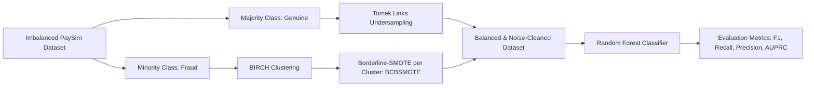

# Hybrid Undersampling and Oversampling for Handling Imbalanced Credit Card Data

[](https://www.python.org/downloads/)
[](https://scikit-learn.org/)
[](https://opensource.org/licenses/MIT)

Implementation of the fraud detection architecture proposed in the research paper:
> **"Hybrid Undersampling and Oversampling for Handling Imbalanced Credit Card Data"**  
> *Maram Alamri and Mourad Ykhlef*  
> **IEEE Access**, vol. 12, pp. 14050–14060, 2024.  
> DOI: [10.1109/ACCESS.2024.3357091](https://doi.org/10.1109/ACCESS.2024.3357091)

---

## 📌 1. Paper Overview & Methodology

Financial fraud detection is characterized by severe class imbalance—fraudulent events typically account for less than **0.13%** of all transactions. Conventional sampling techniques (such as standard SMOTE or random undersampling) suffer from:
- **Overfitting & Noise Generation**: Oversampling without clustering creates synthetic instances in noisy or overlapping regions.
- **Information Loss**: Aggressive undersampling discards crucial decision patterns from the majority class.

### 🔬 Proposed Hybrid Resampling Architecture (Figure 5)



1. **Tomek Links Undersampling (Algorithm 1)**:
   - Identifies pairs $(x, y)$ where $x \in \text{majority}$ and $y \in \text{minority}$ are mutual nearest neighbors.
   - Eliminates the majority sample $x$ to clear boundary noise and clarify decision margins.
2. **BIRCH Clustering Borderline SMOTE - BCBSMOTE (Algorithms 2 & 3)**:
   - **Clustering (BIRCH)**: Partitions minority instances using a CF tree to capture local sub-structures.
   - **Noise Filtering**: Clusters smaller than `cluster_size = 5` are dropped.
   - **Proportional Sample Allocation**: Quotas are distributed proportionally across clusters based on their member count.
   - **Borderline-SMOTE (Algorithm 2)**: Identifies minority points in the **Danger** zone ($m/2 \le m' < m$ majority neighbors) and interpolates locally within the cluster:
     $$x_{new} = x_i + \beta (x_{zi} - x_i), \quad \beta \in [0, 1]$$
3. **Random Forest Classifier (Section V.D)**:
   - Trained on the balanced, resampled feature space.
   - Evaluated on the held-out 20% test partition (1.27 million transactions).

---

## 📊 2. Comparative Benchmark Results

Results comparing sampling techniques evaluated on the PaySim dataset using Random Forest:

| Resampling Method | Accuracy | F1-Score | Recall | Precision | AUPRC |
| :--- | :---: | :---: | :---: | :---: | :---: |
| **RF with SMOTE** | 99.92% | 77.71% | 97.07% | 64.78% | 62.89% |
| **RF with B-SMOTE** | 99.95% | 84.67% | 89.47% | 80.37% | 71.92% |
| **RF with ADASYN** | 99.92% | 76.98% | 97.80% | 63.46% | 62.07% |
| **RF with SMOTE-Tomek** | 99.92% | 77.81% | 97.44% | 64.76% | 63.11% |
| **RF with SMOTEENN** | 99.90% | 71.65% | 97.26% | 56.72% | 55.17% |
| **Hybrid Tomek links BCBSMOTE (Proposed)** | **99.95%** | **85.20%** | **89.53%** | **81.27%** | **72.77%** |

*Confusion matrix for the proposed method on the test set (Table 5):*
- **True Positives (Fraud Caught)**: 1,471 / 1,643 (**89.53% Recall**)
- **False Positives (False Alarms)**: 339 (**81.27% Precision**)
- **True Negatives (Legitimate Cleared)**: 1,270,542
- **False Negatives (Fraud Missed)**: 172

---

## 📁 3. Project Directory Structure

```
ml reserch/
├── archive/
│   └── PS_20174392719_1491204439457_log.csv   # PaySim dataset (6.36M rows)
├── data/
│   └── sample_transactions.csv                # Sample transactions for inference
├── models/
│   ├── fraud_detection_model.joblib           # Trained Random Forest model checkpoint
│   └── label_encoder.joblib                   # Fitted transaction type encoder
├── notebooks/
│   └── credit_card_fraud_detection.ipynb      # Interactive Jupyter notebook
├── results/
│   ├── figure_1_class_distribution.png        # Normal vs Fraud distribution
│   ├── figure_10_auprc_curve.png              # Precision-Recall curve
│   ├── table_5_confusion_matrix.png           # Confusion matrix heatmap
│   └── evaluation_metrics_summary.csv         # Exported metrics
├── src/
│   ├── __init__.py                            # Package init
│   ├── preprocessing.py                       # Data cleaning, encoding & stratified splitting
│   ├── sampling.py                            # TomekLinks, BCBSMOTE, and baseline samplers
│   ├── model.py                               # FraudDetectionModel wrapper & threshold tuning
│   └── visualization.py                       # Plotting utilities for IEEE Access figures
├── train.py                                   # CLI script for model training
├── predict.py                                 # CLI script for real-time and batch scoring
├── run_benchmark.py                           # CLI script for Table 4 / Figure 9 comparisons
├── requirements.txt                           # Python dependencies
└── README.md                                  # Complete project documentation
```

---

## 🚀 4. Quickstart & Installation

### Step 1: Install Dependencies
```bash
pip install -r requirements.txt
```

### Step 2: Train the Model

To train the proposed model on the dataset:
```bash
# Fast training on a representative subset (200k rows):
python train.py --sample_size 200000

# Full training on all 6.36 million records:
python train.py
```

Optional training arguments:
- `--sampling_ratio`: Target ratio of minority to majority class (default: `0.02`).
- `--cluster_size`: Minimum BIRCH cluster size (default: `5`).
- `--n_estimators`: Number of decision trees in Random Forest (default: `50`).
- `--max_depth`: Maximum tree depth (default: `15`).
- `--model_save_path`: Path to save trained checkpoint (default: `models/fraud_detection_model.joblib`).

---

## 🔮 5. Running Predictions & Inference

### A. Predict on a Single Transaction
```bash
python predict.py \
  --step 1 \
  --type PAYMENT \
  --amount 1000.0 \
  --oldbalanceOrg 5000.0 \
  --oldbalanceDest 0.0 \
  --newbalanceDest 0.0
```
Output:
```text
==================================================
      TRANSACTION FRAUD DETECTION RESULT
==================================================
Transaction Type  : PAYMENT
Amount            : $1,000.00
Initial Bal (Orig): $5,000.00
Initial Bal (Dest): $0.00
New Bal (Dest)    : $0.00
--------------------------------------------------
Fraud Probability : 3.33%
Prediction        : [LEGITIMATE] (Class 0)
Risk Level        : LOW
==================================================
```

### B. Batch Prediction on a CSV File
```bash
python predict.py --input_csv data/sample_transactions.csv --output_csv results/predictions.csv
```

---

## 📈 6. Running Benchmark Comparisons

To reproduce the benchmark comparison table (Table 4) and comparison bar chart (Figure 9):
```bash
python run_benchmark.py --sample_size 200000
```
Outputs are saved to `results/table_4_benchmark_evaluation.csv` and `results/figure_9_benchmark_comparison.png`.

---

## 📓 7. Interactive Jupyter Notebooks

This repository provides two dedicated notebooks:

### A. Phase 1 Enhanced Notebook (Coursework Phase 2/3 Preparation)
Located at: [`notebooks/phase1_enhanced_fraud_detection.ipynb`](notebooks/phase1_enhanced_fraud_detection.ipynb)  
- **Dataset:** European Cardholders Credit Card Transactions (`archive/creditcard.csv`, OpenML ID 1597, 284,807 transactions).
- **Core Enhancements Implemented from Phase 1 Document:**
  1. **Deduplication:** Addresses 9,144 duplicate rows to prevent cross-validation leakage.
  2. **Scale Dominance Correction:** Replaces unscaled distances with training-isolated `RobustScaler` (solves `Amount` swamping $V_1–V_{28}$).
  3. **Strict Anti-Leakage CV:** Implements Stratified 5-Fold Cross-Validation where scaling and BCBSMOTE resampling happen strictly inside training folds.
  4. **Comprehensive Metric Suite:** Computes **AUPRC**, **MCC**, **F1-Score**, **Precision**, **Recall**, and **Cost-Sensitive Financial Loss**.
  5. **Systematic Ablation Study:** Evaluates *None vs Tomek Links vs Borderline-SMOTE vs Full BCBSMOTE*.
  6. **Model Benchmarking:** Compares Random Forest against Logistic Regression, XGBoost, and Balanced Random Forest.
  7. **Stress-Testing Suite:** Evaluates model resilience under label noise injection (1%–10%) and critical feature degradation ($V_{14}, V_{17}, V_{12}$).

```bash
jupyter notebook notebooks/phase1_enhanced_fraud_detection.ipynb
```

### B. Original Paper Baseline Notebook
Located at: [`notebooks/credit_card_fraud_detection.ipynb`](notebooks/credit_card_fraud_detection.ipynb)  
- **Dataset:** PaySim Synthetic Financial Transactions (`archive/PS_20174392719_1491204439457_log.csv`, 6.36M records).
- **Workflow:** End-to-end replication of the original paper pipeline (Figures 1–4, 7, 10, Table 4 & 5).

```bash
jupyter notebook notebooks/credit_card_fraud_detection.ipynb
```

---

## 📖 Citation
If you use this model or code in your research, please cite:
```bibtex
@ARTICLE{10410196,
  author={Alamri, Maram and Ykhlef, Mourad},
  journal={IEEE Access}, 
  title={Hybrid Undersampling and Oversampling for Handling Imbalanced Credit Card Data}, 
  year={2024},
  volume={12},
  pages={14050-14060},
  doi={10.1109/ACCESS.2024.3357091}
}
```
